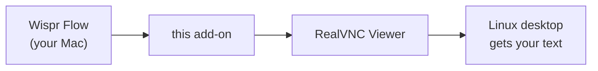

# wisprflow-realvnc-hack

**A small macOS add-on that lets [Wispr Flow](https://wisprflow.ai) dictation paste into a Linux
desktop you control through [RealVNC Viewer](https://www.realvnc.com/en/connect/download/viewer/).**

Normally, when you dictate into the RealVNC window, Linux receives only the letter `v`. With this
add-on, your text shows up.



## Is this for you?

You need all of these:

- **A Mac.** This add-on does not run on Windows or Linux.
- **Wispr Flow** and **RealVNC Viewer** on that Mac.
- A **Linux** machine that you open in RealVNC Viewer. Nothing is installed on the Linux side.

This is not a standalone app. It works alongside Wispr Flow and RealVNC Viewer, using
[Hammerspoon](https://www.hammerspoon.org) (a free Mac automation tool that the installer sets
up).

## Install

**With an AI agent** (Claude Code, Cursor, Codex, …). Tell it:

> Clone https://github.com/ivany-nv/wisprflow-realvnc-hack and set it up by following AGENTS.md.

**By hand:**

```bash
git clone https://github.com/ivany-nv/wisprflow-realvnc-hack.git
cd wisprflow-realvnc-hack && ./install.sh
```

Either way, macOS will ask you to allow **Hammerspoon** under **System Settings → Privacy &
Security → Accessibility**.

## Good to know

- The window flickers once each time you dictate into RealVNC. This is expected, and the text
  lands in under a second.
- Only Wispr Flow's paste into RealVNC changes. Everything else works as before.
- Linux terminals paste with Ctrl+Shift+V. See `pasteMethod` in [AGENTS.md](AGENTS.md).
- To remove the add-on, run `./install.sh --uninstall`.

[How it works](docs/HOW_IT_WORKS.md) · [Troubleshooting](docs/TROUBLESHOOTING.md)

---

Tested on macOS 26 with an X11 Linux desktop. Apache-2.0 license. Not affiliated with Wispr or
RealVNC.
